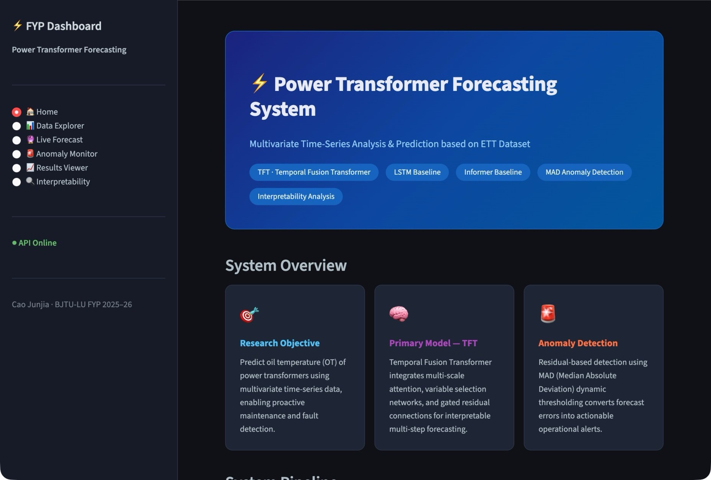
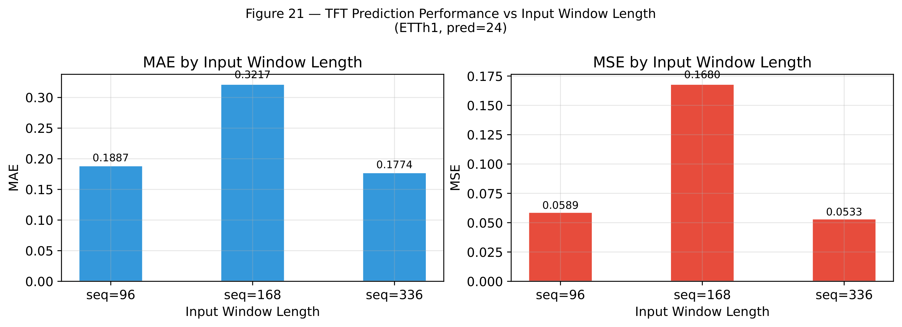
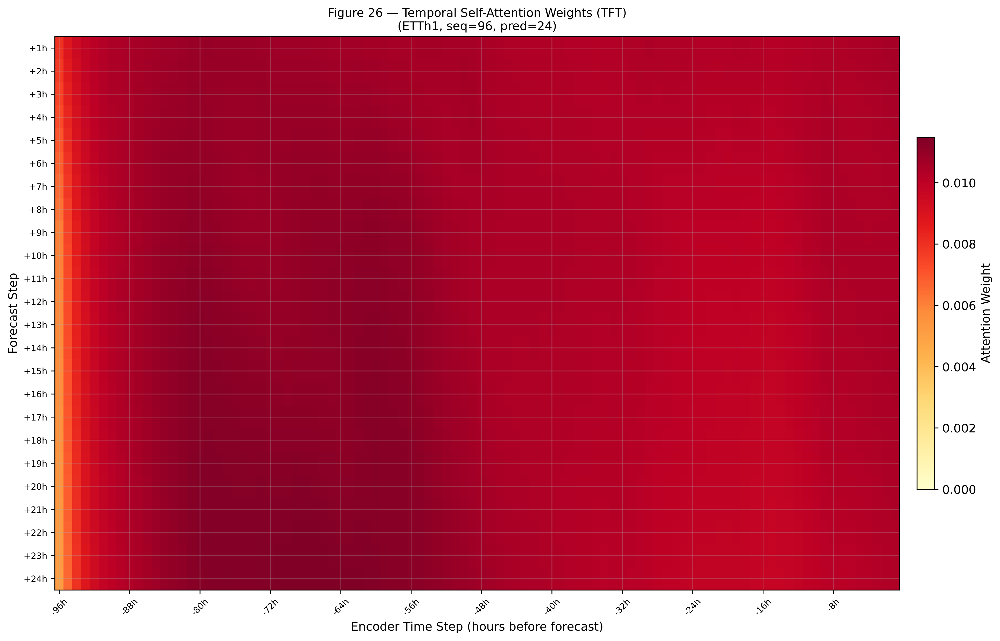

# TFT Time-Series Forecasting

A research and engineering project for interpretable multivariate time-series forecasting, built around a from-scratch PyTorch implementation of the Temporal Fusion Transformer (TFT).

The project combines model implementation, controlled experiments, interpretability analysis, and an interactive FastAPI + Streamlit application. It was developed as Cao Junjia's undergraduate graduation project.

[Final thesis (Chinese, PDF)](docs/thesis.pdf) · [Experiment tables](results/metrics/thesis_tables.csv) · [Third-party notices](THIRD_PARTY_NOTICES.md)

## Highlights

- **TFT from scratch:** GLU, GRN, Variable Selection Networks, LSTM encoder–decoder, and interpretable multi-head attention.
- **Leakage-safe decoder inputs:** historical observations and known time features are both used; future observed values are zeroed before inference.
- **Comparative experiments:** TFT, LSTM, and Informer across ETT, Weather, and ECL configurations.
- **Ablations:** input-window lengths and prediction horizons, collected in machine-readable result tables.
- **Interpretability:** temporal attention heatmaps and variable-selection weights.
- **End-to-end application:** FastAPI inference endpoints and a Streamlit dashboard for data exploration, forecasting, saved results, anomaly monitoring, and interpretability.



## Selected Results

ETTh1, `seq_len=96`, `pred_len=24`. These are the preserved thesis experiment results, not metrics from a new training run during repository cleanup.

| Model | MAE | MSE | RMSE | MAPE |
| --- | ---: | ---: | ---: | ---: |
| TFT | **0.1887** | **0.0589** | **0.2426** | 23.65% |
| LSTM | 0.2170 | 0.0840 | 0.2898 | **22.29%** |
| Informer | 0.2849 | 0.1302 | 0.3608 | 28.82% |

TFT achieves the lowest MAE, MSE, and RMSE on this run; LSTM has the lowest MAPE. The complete cross-dataset and ablation tables are in [`results/metrics/thesis_tables.csv`](results/metrics/thesis_tables.csv).



### Interpretability Example



Additional prediction, window-ablation, error-analysis, anomaly-monitoring, and variable-importance figures are in [`results/figures/`](results/figures/).

## Repository Structure

```text
.
├── app/
│   ├── api/                 # FastAPI routes, schemas, and inference service
│   └── streamlit/           # Interactive dashboard
├── configs/                 # YAML experiment configurations
├── data/                    # Dataset instructions; raw CSV files are ignored
├── docs/thesis.pdf          # Final thesis
├── results/
│   ├── ETTh1/tft/           # Preserved main result bundle
│   ├── figures/             # Selected thesis figures
│   ├── metrics/             # Comparison and ablation tables
│   └── variable_importance/
├── scripts/                 # Experiment orchestration and figure generation
├── src/
│   ├── data/                # Chronological splitting, scaling, time features
│   ├── evaluation/          # Metrics, plots, anomaly monitoring, explanations
│   ├── experiment/          # Train, evaluate, predict, and ablate
│   ├── model/               # TFT and baseline adapters
│   └── utils/
└── third_party/informer2020 # Upstream baseline and its license
```

## Setup

Python 3.10+ is recommended. The cleaned project was verified with Python 3.14 and PyTorch 2.10.

```bash
python -m venv .venv
source .venv/bin/activate        # Windows: .venv\Scripts\activate
pip install -r requirements.txt
```

Download the public datasets by following [`data/README.md`](data/README.md). For the main experiment, place ETTh1 at:

```text
data/raw/ETT/ETTh1.csv
```

## Train and Evaluate

Train the main TFT configuration:

```bash
python -m src.experiment.train --config configs/tft_etth1_96_24.yaml
```

Evaluate its best checkpoint on the test split:

```bash
python -m src.experiment.test --config configs/tft_etth1_96_24.yaml
```

The checkpoint is written to:

```text
results/checkpoints/tft_ETTh1_96_24/best_model.pt
```

Model weights are intentionally not tracked. To reproduce the full experiment matrix, run:

```bash
bash scripts/run_all_experiments.sh
```

The full matrix trains many models and can take substantial time and storage. Run individual configurations when only selected results are needed.

## Run the Application

Start the API from the repository root:

```bash
uvicorn app.api.main:app --reload --port 8000
```

In another terminal:

```bash
streamlit run app/streamlit/app.py
```

The API requires a trained checkpoint for inference. The local candidate directory may contain an ignored checkpoint used for verification; a fresh clone should train one first or supply an equivalent checkpoint at the path above.

API endpoints:

- `GET /health` — liveness check
- `GET /models` — list configurations and checkpoint availability
- `POST /predict` — run inference on supplied arrays
- `GET /results/{run_id}/metrics` — read preserved metrics
- `GET /results/{run_id}/attention` — read preserved TFT attention weights

Interactive API documentation is available at `http://localhost:8000/docs`.

## Research Scope and Limitations

- This is a thesis research implementation, not a production forecasting service.
- Reported MAE, MSE, and RMSE use the preserved experiment configuration, including normalized target values where `inverse_scale: False`.
- MAPE can be unstable when target values are close to zero, especially on ETTh2, Weather, and ECL; it should not be interpreted alone.
- The preserved summary has no TFT result for ECL. Missing results are left blank rather than inferred or backfilled.
- MAD residual monitoring is an applied extension, not a claim of ground-truth anomaly detection on ETT. Its reported precision/recall/F1 evaluation uses synthetically injected residual anomalies.
- Attention and variable-selection weights provide model-oriented interpretability signals, not causal explanations.

## Author and References

**Cao Junjia** — undergraduate graduation project, 2025–26.

- Lim et al., [*Temporal Fusion Transformers for Interpretable Multi-horizon Time Series Forecasting*](https://arxiv.org/abs/1912.09363), 2021.
- Zhou et al., [*Informer: Beyond Efficient Transformer for Long Sequence Time-Series Forecasting*](https://arxiv.org/abs/2012.07436), AAAI 2021.

See [`THIRD_PARTY_NOTICES.md`](THIRD_PARTY_NOTICES.md) for upstream code and dataset attribution.

## License

Original source code and project documentation are released under the [MIT License](LICENSE).

The final thesis in [`docs/thesis.pdf`](docs/thesis.pdf) is released separately under [CC BY 4.0](docs/LICENSE.md). Third-party code and datasets remain subject to their original licenses and terms; see [`THIRD_PARTY_NOTICES.md`](THIRD_PARTY_NOTICES.md).
